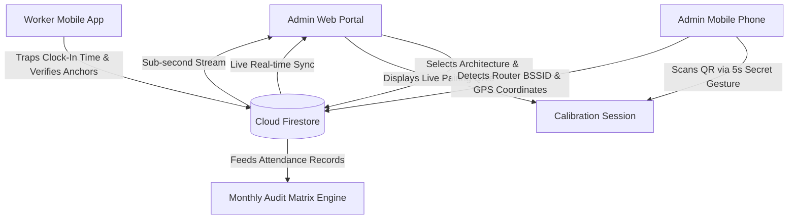

# Presenti — Admin Web Portal

[](https://react.dev/)
[](https://www.typescriptlang.org/)
[](https://vitejs.dev/)
[](https://firebase.google.com/)
[](https://presenti-admin-web.vercel.app)

**Presenti** is an enterprise workforce attendance and physical presence verification ecosystem. It eliminates proxy attendance, buddy punching, and location spoofing through multi-tiered physical verification combining hardware Wi-Fi BSSID radio analysis, satellite GPS geofencing, and device biometric locks.

This repository contains the **Admin Web Portal**, the central command dashboard for organizational leadership to monitor live workforce attendance, configure attendance windows and service policies, pair premises presence anchors, and audit attendance records.

---

## Live Production Deployment

- **Production Portal:** [https://presenti-admin-web.vercel.app](https://presenti-admin-web.vercel.app)

---

## Core Capabilities & Features

### 1. Dual Physical Verification Architecture
- **Option 1 — Hybrid (Physical Office Wi-Fi Router + GPS Geofence):**
  - **Primary Gateway:** Smartphones scan the physical router MAC address (BSSID) from surrounding airwaves. Prevents workers from spoofing network names or using personal mobile hotspots.
  - **Automatic GPS Failover:** Seamlessly falls back to GPS perimeter verification if the physical router is temporarily unreachable.
- **Option 2 — Router-Free (Satellite GPS Geofence Only):**
  - Designed for mobile teams, field workers, pop-up events, and workspaces without dedicated routers.
  - Workers verify presence against a customizable satellite GPS perimeter (10m to 100m radius).

### 2. QR Mobile Calibration Station
- **Real-Time Handshake Bridge:** Generates encrypted, short-lived QR codes for instant pairing with the administrator's smartphone.
- **Remote Mobile Calibration:** Administrators trigger the calibration scanner on their phone via a secret 5-second press-and-hold on the Presenti logo.
- **Two-Way Live Session Sync:** Displays live session status (`AWAITING_SCAN` → `CONNECTED` → `COMPLETED`) via real-time Firestore listeners.
- **Intelligent Architecture Wizard:**
  - **Step 1:** Select workplace architecture (Office Router vs. Router-Free GPS).
  - **Step 2:** Router prerequisite checklist with hotspot detection notice.
  - Synchronous data mounting eliminates any split-second "Pending Calibration" flashes.

### 3. Interactive Web Geofence & Location Editor
- **Interactive Pinpoint & Search:** Search venue addresses or pinpoint coordinates directly on satellite maps with OpenStreetMap / Google Maps integration.
- **Perimeter Presets:** Select radius presets (10m, 20m, 30m, 40m, 50m, 80m, 100m) with real-time diameter calculation and live visual confirmation.
- **Browser Geolocation Fallback:** Instant "Use Current Location" button for on-site administrative calibration.

### 4. Real-Time Dashboard & Live Attendance Stream
- **Live Attendance Metrics:** Real-time counts for Present, Late, and Absent workers with live velocity indicators.
- **Dynamic Attendance Stream:** Sub-second Firestore snapshot stream displaying clock-ins the millisecond workers punch in.
- **Audit Trail:** Traps arrival timestamps, verification method (`WIFI_BSSID` vs. `GEO_FALLBACK`), and device hardware signatures.

### 5. Monthly Audit Matrix & Export Engine
- **Scheduled Day Aggregation:** Automatically groups workforce attendance across designated meeting and service days (e.g. Sundays, Wednesdays, weekdays).
- **Status & Punctuality Matrix:** Color-coded status badges for on-time, late, and absent attendance across months.
- **CSV & Excel Export:** One-click data exports for payroll processing and institutional reporting.

### 6. Workforce & Device Binding Management
- **Organization Pairing Codes:** Automated format (`XX-XXX-XXX`, e.g., `TO-CRR-656`) for streamlined employee onboarding.
- **Hardware Device Lock:** Cryptographically links each employee's account to their registered smartphone hardware identifier.
- **Administrative Device Reset:** Allows administrators to unbind or transfer devices when an employee replaces their smartphone.

---

## System Architecture



---

## Tech Stack

| Layer | Technology |
|---|---|
| **Frontend Framework** | React 18 (TypeScript) |
| **Build Tooling** | Vite 5 |
| **Styling** | Vanilla CSS Modules + Tailwind CSS + Lucide Icons |
| **Map & Geocoding** | Leaflet / React-Leaflet + OpenStreetMap Nominatim |
| **Database & Auth** | Firebase Authentication + Cloud Firestore |
| **Deployment** | Vercel Serverless Hosting |

---

## Getting Started

### Prerequisites
- Node.js 18.x or 20.x
- npm or yarn

### Installation

1. Clone the repository:
   ```bash
   git clone https://github.com/kachiDeGreat/Presenti-web-admin.git
   cd Presenti-web-admin
   ```

2. Install dependencies:
   ```bash
   npm install
   ```

3. Configure Environment Variables:
   Create a `.env` file in the project root:
   ```env
   VITE_FIREBASE_API_KEY=your_firebase_api_key
   VITE_FIREBASE_AUTH_DOMAIN=your_project.firebaseapp.com
   VITE_FIREBASE_PROJECT_ID=your_project_id
   VITE_FIREBASE_STORAGE_BUCKET=your_project.appspot.com
   VITE_FIREBASE_MESSAGING_SENDER_ID=your_sender_id
   VITE_FIREBASE_APP_ID=your_app_id
   VITE_GOOGLE_MAPS_API_KEY=your_google_maps_api_key
   ```

4. Run locally:
   ```bash
   npm run dev
   ```

5. Build for production:
   ```bash
   npm run build
   ```

---

## Git Branches

- `master`: Production release branch.
- `stable`: Verified, stable release checkpoint.

---

## Related Repositories

- **Mobile Client Application (Expo / React Native):** [kachiDeGreat/Presenti-mobile](https://github.com/kachiDeGreat/Presenti-mobile)
- **Live Admin Web Portal:** [https://presenti-admin-web.vercel.app](https://presenti-admin-web.vercel.app)

---

## License

Private & Proprietary — Developed for Presenti Workforce Systems.
