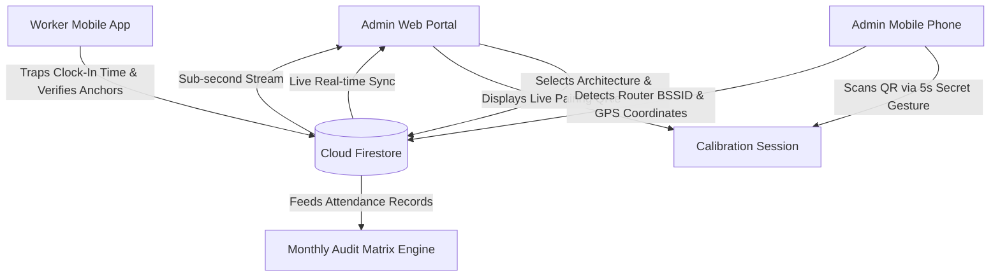

# Presenti — Admin Web Portal

[](https://react.dev/)
[](https://www.typescriptlang.org/)
[](https://vitejs.dev/)
[](https://firebase.google.com/)
[](https://presenti-admin-web.vercel.app)

**Presenti** is an enterprise workforce attendance and physical presence verification ecosystem. It eliminates proxy attendance, buddy punching, and location spoofing through multi-tiered physical verification combining hardware Wi-Fi BSSID radio analysis, satellite GPS geofencing, and device biometric locks.

This repository contains the **Admin Web Portal**, the central command dashboard for organizational leadership to monitor live workforce attendance, configure attendance windows and service policies, pair premises presence anchors, and audit attendance records.

---

## Live Production Deployment

- **Production Portal:** [https://presenti-admin-web.vercel.app](https://presenti-admin-web.vercel.app)

---

## Core Capabilities & Features

### 1. Dual Physical Verification Architecture
- **Option 1 — Satellite GPS Geofence (Router-Free · Default & Recommended):**
  - **Instant Setup:** Calibrates using high-precision satellite GPS coordinates and customizable perimeter radii (10m to 100m).
  - **Zero Hardware Overhead:** Ideal for modern offices, field operations, pop-up events, and mobile workspaces without needing dedicated routers.
  - **High-Velocity Clock-In:** Zero radio scan waiting period; instant sub-second verification.
- **Option 2 — Physical Office Wi-Fi Router (Hybrid · Optional Dual-Tier):**
  - **Tier 1 — Hardware Wi-Fi Anchor (BSSID):** Verifies the physical router MAC address (BSSID) from surrounding airwaves, preventing workers from spoofing network names or using personal mobile hotspots.
  - **Tier 2 — Automatic GPS Failover:** Seamlessly falls back to GPS perimeter verification if the physical router radio is temporarily unreachable.

### 2. QR Mobile Calibration Station
- **Real-Time Handshake Bridge:** Generates encrypted, short-lived QR codes for instant pairing with the administrator's smartphone.
- **Remote Mobile Calibration:** Administrators trigger the calibration scanner on their phone via a secret 5-second press-and-hold on the Presenti logo.
- **Two-Way Live Session Sync:** Displays live session status (`AWAITING_SCAN` → `CONNECTED` → `COMPLETED`) via real-time Firestore listeners.
- **Intelligent Architecture Wizard:**
  - **Step 1:** Select workplace architecture (Office Router vs. Router-Free GPS).
  - **Step 2:** Router prerequisite checklist with hotspot detection notice.
  - Synchronous data mounting eliminates any split-second "Pending Calibration" flashes.

### 3. Smart Policy Configuration & Punctuality Engine
- **Schedule Configuration Modes (`scheduleMode`):**
  - **One Time for All Days (`UNIFIED` · Default):** Configures a single arrival open time, cutoff time, late tolerance setting, and departure sign-out hour that applies uniformly across every selected active operating day.
  - **Different Times per Day (`PER_DAY`):** Designed for organizations with variable service schedules (e.g. churches with Sunday morning call-ups at 07:00 AM and mid-week evening services at 05:30 PM, or businesses with shorter Friday workdays).
    - **Active Day Tab Selector:** Interactive day tabs allowing administrators to switch between and configure any active day selected in the schedule.
    - **Day Editor Box:** Independently customize Sign-In Window Open Time, Close Time, Late Tagging (`allowLateSignIn`), and Sign-Out (`enableSignOut` + `signOutTime`) for each day.
    - **Apply to All Active Days:** One-click batch button to propagate the current day's time settings to all other selected days.
    - **All Days Overview Grid:** At-a-glance summary cards showing every active day's call-up window, punctuality rules, and sign-out hours.
- **Sign-In Window Times:** Configure official **Sign-In Open Time** (e.g., 07:00 AM) and **Sign-In Close Time** (e.g., 07:30 AM).
- **Grace Period & Late Tagging (`allowLateSignIn`):**
  - **Grace Period Enabled:** Workers who clock in after the window closes are permitted to register attendance, but their record is tagged with an amber **`LATE`** badge across all dashboards, matrices, and exports.
  - **Zero Late Tolerance:** When disabled, sign-in strictly locks when the close window passes.
- **Biometric Departure Sign-Out (`enableSignOut`):**
  - Administrators can enable mandatory/optional end-of-day sign-outs.
  - Set a **Sign-Out Time** (e.g., 05:00 PM / 17:00).
  - **No Closing Cutoff & No Late Penalty:** Sign-out remains permanently open from the configured departure time until midnight.
- **Zero Sync Cutoff Overhead:**
  - Removed cumbersome daily cloud sync cutoffs. All punches buffered offline are automatically pushed by the client app before the next working day.

### 4. Interactive Web Geofence & Location Editor
- **Interactive Pinpoint & Search:** Search venue addresses or pinpoint coordinates directly on satellite maps with OpenStreetMap / Google Maps integration.
- **Perimeter Presets:** Select radius presets (10m, 20m, 30m, 40m, 50m, 80m, 100m) with real-time diameter calculation and live visual confirmation.
- **Browser Geolocation Fallback:** Instant "Use Current Location" button for on-site administrative calibration.

### 5. Real-Time Dashboard & Live Attendance Stream
- **Live Attendance KPI Cards:** Real-time counts for **Total Present**, **On-Time Arrivals**, **Late Arrivals**, and **Signed Out Workers**.
- **Dynamic Attendance Stream:** Sub-second Firestore snapshot stream displaying clock-ins the millisecond workers punch in.
- **Detailed Audit Trail:** Displays arrival timestamp, punctuality badge (`ON-TIME` vs. `LATE`), departure sign-out timestamp, verification method (`WIFI_BSSID` vs. `GEO_FALLBACK`), native biometric confirmation, and device hardware signatures.

### 6. Monthly Audit Matrix & Export Engine
- **Scheduled Day Aggregation:** Automatically groups workforce attendance across designated meeting and service days (e.g. Sundays, Wednesdays, weekdays).
- **Status & Punctuality Matrix:** Color-coded status badges for on-time, late, and absent attendance across months, including arrival and departure times.
- **CSV & Excel Export:** One-click data exports for payroll processing and institutional reporting.

### 7. Workforce & Device Binding Management
- **Randomized Organization Pairing Codes:** High-entropy format (`XX-XXX-XXX`, e.g., `KW-RTX-482`) completely decoupled from location names to eliminate stale initials when changing state or premises.
- **Hardware Device Lock:** Cryptographically links each employee's account to their registered smartphone hardware identifier.
- **Administrative Device Reset:** Allows administrators to unbind or transfer devices when an employee replaces their smartphone.

---

## System Architecture



---

## Tech Stack

| Layer | Technology |
|---|---|
| **Frontend Framework** | React 18 (TypeScript) |
| **Build Tooling** | Vite 5 |
| **Styling** | Vanilla CSS Modules + Tailwind CSS + Lucide Icons |
| **Map & Geocoding** | Leaflet / React-Leaflet + Multi-Tier Geocoding (Google Maps API + Photon Nigeria BBox + Nominatim) |
| **Database & Auth** | Firebase Authentication + Cloud Firestore |
| **Deployment** | Vercel Serverless Hosting |

---

## Smart Location Pinpointing & Geocoding

The premises calibration engine integrates multi-tiered geocoding:
1. **Nigerian State Abbreviation Normalization:** Automatically expands state codes (e.g., `CRS` &rarr; `Cross River State`, `FCT` &rarr; `Abuja`, `LG` &rarr; `Lagos State`, `PH` &rarr; `Port Harcourt`).
2. **Nigeria Bounding Box Enforcement:** Scopes searches with bounding box `bbox=2.6769,4.2725,14.6778,13.8920` and `countrycodes=ng` to completely eliminate false positives overseas.
3. **Google Maps Geocoding API Support:** Optional integration with Google Maps Platform via `VITE_GOOGLE_MAPS_API_KEY` ($200 monthly free tier).
4. **Coordinate & Link Parser:** Direct recognition and parsing of Google Maps URLs, `@lat,lng` strings, and raw coordinates.

---

## Getting Started

### Prerequisites
- Node.js 18.x or 20.x
- npm or yarn

### Installation

1. Clone the repository:
   ```bash
   git clone https://github.com/kachiDeGreat/Presenti-web-admin.git
   cd Presenti-web-admin
   ```

2. Install dependencies:
   ```bash
   npm install
   ```

3. Configure Environment Variables:
   Create a `.env` file in the project root:
   ```env
   VITE_FIREBASE_API_KEY=your_firebase_api_key
   VITE_FIREBASE_AUTH_DOMAIN=your_project.firebaseapp.com
   VITE_FIREBASE_PROJECT_ID=your_project_id
   VITE_FIREBASE_STORAGE_BUCKET=your_project.appspot.com
   VITE_FIREBASE_MESSAGING_SENDER_ID=your_sender_id
   VITE_FIREBASE_APP_ID=your_app_id
   VITE_GOOGLE_MAPS_API_KEY=your_google_maps_api_key
   ```

4. Run locally:
   ```bash
   npm run dev
   ```

5. Build for production:
   ```bash
   npm run build
   ```

---

## Git Branches

- `master`: Production release branch.
- `stable`: Verified, stable release checkpoint.

---

## Related Repositories

- **Mobile Client Application (Expo / React Native):** [kachiDeGreat/Presenti-mobile](https://github.com/kachiDeGreat/Presenti-mobile)
- **Live Admin Web Portal:** [https://presenti-admin-web.vercel.app](https://presenti-admin-web.vercel.app)

---

## License

Private & Proprietary — Developed for Presenti Workforce Systems.
