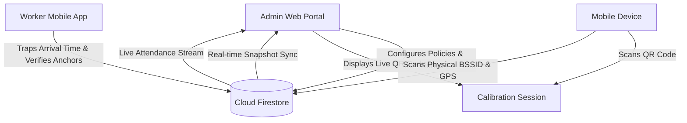

# Presenti — Admin Web Portal

[](https://react.dev/)
[](https://www.typescriptlang.org/)
[](https://vitejs.dev/)
[](https://tailwindcss.com/)
[](https://firebase.google.com/)
[](https://presenti-admin-web.vercel.app)

**Presenti** is an enterprise-grade attendance tracking and physical presence verification ecosystem. It eliminates proxy attendance, buddy punching, and location spoofing through a multi-tiered physical verification hierarchy combining hardware Wi-Fi BSSID anchors, GPS perimeter geofencing, and device biometric/hardware binding.

This repository hosts the **Admin Web Portal**, the centralized administrative dashboard used by organization leadership to monitor live workforce attendance, configure attendance policies, bind premises anchors, and manage member credentials.

---

## Live Production Deployment

- **Production Portal:** [https://presenti-admin-web.vercel.app](https://presenti-admin-web.vercel.app)

---

## Core Capabilities & Features

### 1. Real-Time Executive Dashboard
- **Live Attendance Metrics:** Real-time counts for Present, Late, and Absent personnel with live velocity tracking.
- **Dynamic Attendance Stream:** Real-time feed powered by Firebase Firestore listeners displaying clock-in events the instant workers punch in.
- **Department Breakdown:** Instant visual breakdown of attendance rates across configured departments and units.
- **Time Trapping Audit:** Complete audit trail displaying trapped arrival timestamps, verification method (Wi-Fi Anchor vs. GPS Geofence), and hardware device signatures.

### 2. Dual-Tier Physical Premises Anchors
- **Tier 1 — Hardware Wi-Fi Anchor (BSSID):** Binds attendance to the organization's physical router hardware MAC address (BSSID) rather than just an easily spoofable network name (SSID).
- **Tier 2 — GPS Perimeter Geofence:** Configurable fallback perimeter (10m to 100m) with interactive OpenStreetMap/Leaflet visualization. Workers outside the perimeter cannot clock in.
- **Interactive Map:** Click-to-place map pin, real-time geofence circle preview, and desktop browser geolocation fallback with cached precision.

### 3. QR Mobile Calibration Gateway
- **Live Handshake Bridge:** Generates encrypted, time-sensitive QR codes allowing administrators to link their mobile app directly to the web portal in real-time.
- **Remote Mobile Calibration:** Activated via a secret 5-second press-and-hold on the mobile app logo (completely invisible to regular workers). Scans on-site Wi-Fi BSSIDs and GPS coordinates, instantly syncing premises anchors back to the web portal.

### 4. Policy & Attendance Window Engine
- **Configurable Service Days:** Multi-day selection (Sundays, Wednesdays, weekdays) matching organizational schedules.
- **Arrival Cutoff & Late Tolerance:** Define exact opening times, late tolerance buffers, and hard close cutoffs. The mobile app automatically blocks clock-ins outside these windows.

### 5. Workforce & Device Binding Management
- **Organization Pairing Codes:** Automated formatting (`XX-XXX-XXX`, e.g. `TO-CRR-656`) for seamless employee enrollment.
- **Hardware Device Lock:** Each worker's account is cryptographically bound to their registered smartphone hardware ID.
- **Admin Device Unbinding:** Organization admins can reset or unbind device locks when a staff member changes or replaces their phone.
- **Data Export:** Instant CSV export of daily and historical attendance records for payroll and reporting.

---

## System Architecture



---

## Tech Stack

| Layer | Technology |
|---|---|
| **Frontend Framework** | React 18 (TypeScript) |
| **Build Tooling** | Vite 5 |
| **Styling** | Tailwind CSS + Lucide React Icons |
| **Interactive Maps** | Leaflet / React-Leaflet + OpenStreetMap |
| **Database & Auth** | Firebase Authentication + Cloud Firestore |
| **Deployment** | Vercel Serverless Hosting |

---

## Getting Started

### Prerequisites
- Node.js 18.x or 20.x
- npm or yarn

### Installation

1. Clone the repository:
   ```bash
   git clone https://github.com/kachiDeGreat/Presenti-web-admin.git
   cd Presenti-web-admin
   ```

2. Install dependencies:
   ```bash
   npm install
   ```

3. Configure Environment Variables:
   Create a `.env` file in the root directory:
   ```env
   VITE_FIREBASE_API_KEY=your_firebase_api_key
   VITE_FIREBASE_AUTH_DOMAIN=your_project.firebaseapp.com
   VITE_FIREBASE_PROJECT_ID=your_project_id
   VITE_FIREBASE_STORAGE_BUCKET=your_project.appspot.com
   VITE_FIREBASE_MESSAGING_SENDER_ID=your_sender_id
   VITE_FIREBASE_APP_ID=your_app_id
   ```

4. Run locally:
   ```bash
   npm run dev
   ```

5. Build for production:
   ```bash
   npm run build
   ```

---

## Related Repositories

- **Mobile Application (Expo / React Native):** [kachiDeGreat/Presenti-mobile](https://github.com/kachiDeGreat/Presenti-mobile)

---

## License

Private & Proprietary — Developed for Presenti Workforce Systems.
